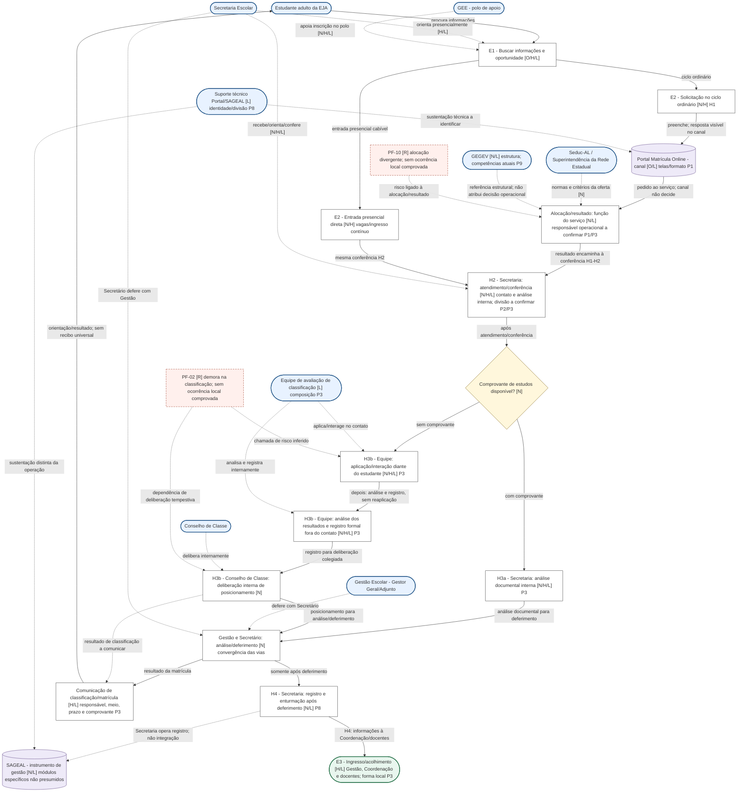
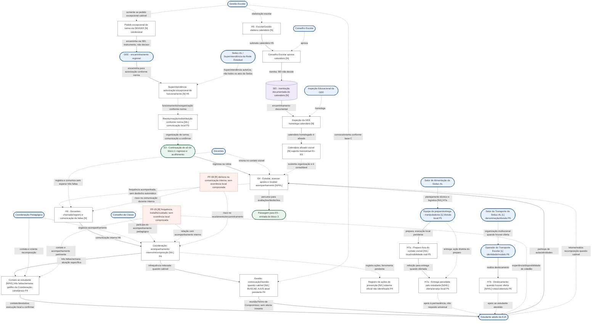
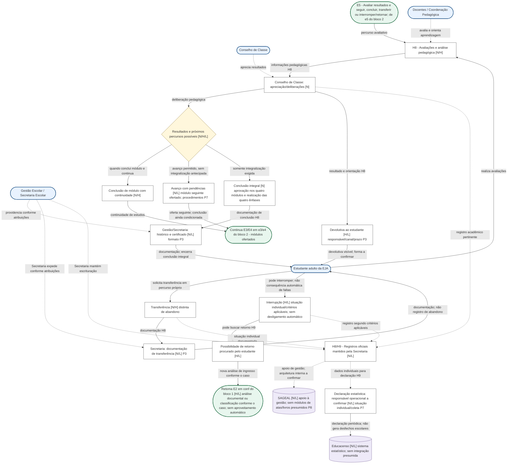

# Diagrama AS-IS — Acesso e permanência na EJA Modular estadual de Alagoas

**Estudante:** Rosy Emannuele Moura dos Santos Bomfim.  
**Elaboração:** Codex / OpenAI, 16/11/2026, após autorização específica da Parte D.  
**Base:** [blueprint corrigido C01/C02](C_blueprint_asis.md) e [dez rodadas da entrevista](C_grill_transcript.md). A/B/C preservados; suas frases históricas de parada registram o momento anterior. [Pedido da Parte D](contexto/parte_d/pedido_parte_d.txt).

## Recorte e legenda

EJA Modular do Ensino Médio estadual de Alagoas, pessoas 18+, acesso e permanência. Perfis plurais de trabalho e cuidado; não se presume turno noturno, emprego formal ou cobertura universal de apoios. AS-IS documental, sem observação de campo ou nova auditoria factual integral.

- Formas arredondadas com nomes de atores identificam responsáveis humanos/funções; retângulos comuns são ações; losangos distinguem decisões. Cilindros são canais/sistemas, sem autonomia decisória. Conectores verdes nomeiam referências entre blocos.
- Setas contínuas rotuladas indicam sequência possível ou encaminhamento de informação/decisão, conforme o rótulo. Não significam inevitabilidade, prazo ou automação. Setas pontilhadas indicam participação, suporte, registro funcional ou chamada de risco; não são passos compulsórios do cidadão nem comprovam API/sincronização ou execução observada.
- **[N]** previsão normativa; **[O]** informação operacional pública; **[H]** hipótese de representação; **[L]** execução local/responsável/formato não verificados; **[R]** risco inferido sem ocorrência local comprovada, sem hierarquia empírica de gravidade. Rótulos combinados mantêm ambos os limites. P1–P9/T1–T9 remetem ao quadro da seção 6 de C.
- A ação determina visibilidade. Aplicação/interação da avaliação diante do estudante é frontstage; análise de resultados, registro e deliberação fora desse contato são backstage. Conferência pode conter contato percebido e análise interna, divisão concreta [H/L] não observada. Não se fixa uma instituição inteira em uma camada.

## 1. Acesso e ingresso — E1, E2 e passagem a E3

Alocação é função do serviço com responsável operacional pendente, sem algoritmo e sem atribuir decisão à GEGEV/portal. Critérios, disponibilidade e formação de turmas podem produzir resultado divergente, sem esgotamento universal das três opções (H1/T1). Documentação segue íntegra e condições do art. 15; encaminhamento sem NIS é P2, sem dispensa ou negativa automática presumida.

**Conexão:** e3 deste bloco corresponde a e3 do bloco 2. Nenhuma entrada pula conf; ambas seguem a bifurcação e o deferimento antes de reg e do ingresso. Comunicação de resultado é distinta dos procedimentos internos; responsável, meio, prazo e comprovante específicos ficam P3.

## 2. Permanência, apoios e governança — E3 e E4

Calendário, apoios e pedido excepcional são sustentação, não tarefas universais do estudante. Reenturmação ao término de bimestre/módulo: art. 23, caput; pedido excepcional via SEI/GEE: parágrafo único; funcionamento autorizado e redistribuição: art. 24, §§ 5º–6º (H5/T3 de C). A autorização excepcional não é requisito de toda matrícula nem comprova configuração de software pela GEE. O calendário sustenta E1–E5; a ligação visual a E4 ilustra seu uso na rotina.

**Conexões:** e5 continua em entrada do bloco 3; e3/e4 recebem a continuidade de e34. Não há seta de alerta de faltas para desligamento. Comunicação docente não espera três faltas; três faltas/semana é o gatilho específico de atuação da Coordenação. BUSCAE é programa; AJUS é previsão estadual com aplicação atual pendente, sem abono irrestrito. O sistema de prevenção continua não identificado. Preparo/entrega têm visibilidades distintas na representação; arranjo e execução local permanecem P5.

## 3. Desfechos, declaração e retorno — E5

Transferência e interrupção são percursos próprios do estudante, não resultados obrigatórios da avaliação. A declaração censitária recebe informação da situação individual e termina no Educacenso: não causa conclusão, abandono, matrícula ou retorno. Resultados intermediários de módulos não equivalem ao rendimento final da etapa. Coleta aplicável, equivalências e compatibilização com progressão parcial permanecem P7; a referência conceitual é o caderno 2025. Sua reabertura durante ajustes de B falhou com HTTP 502, conforme C; não se declara nova consulta bem-sucedida.

**Conexões:** e34 retorna a e3/e4 do bloco 2. e2 retorna a conf do bloco 1, para análise documental ou classificação conforme o caso, sem aproveitamento automático. Educacenso não tem seta para esses retornos. res resume possibilidades pedagógicas, sem garantir aprovação ou esgotar os motivos de transferência/interrupção.

## Correspondência com C

Os H são os códigos do blueprint C, não os handoffs de numeração diferente da pesquisa B.

| Etapas / H de C | Relações/nós em D | Rodadas / fontes e pendências de C | Riscos |
|---|---|---|---|
| E1–E2 / H1 | Bloco 1: e1, ins, portal, aloc e encaminhamento a conf. | Q1–Q4, Q7–Q10; T1/P1/P3 | PF-10 na alocação/resultado |
| E2 / H2 | Bloco 1: aloc e direta convergem em conf antes de bif. | Q2–Q4, Q8–Q10; T1/P2/P3 | Sem risco adicional |
| E2 / H3a | bif → doc → defere, sem classificação universal. | Q2–Q4, Q9–Q10; T1–T2/P3 | Sem risco adicional |
| E2 / H3b | aplica → analisa → delib → defere; comunicação com separada. | Q2–Q4, Q7–Q10; T1–T2/P3 | PF-02 em aplicação/deliberação |
| E2–E3 / H4 | defere → reg → e3; Secretaria opera registro, SAGEAL é instrumento. | Q2–Q4, Q9–Q10; T1/T3/P3/P8 | Sem risco adicional |
| E3 / H5, suporte transversal | Bloco 2: cal → aprova → sei → hom → vis; ramo condicional exc → gee → autor e organização reent. | Q4, Q9–Q10; T3/P3/P8 | Sem risco adicional |
| E4 / H6 | freq → acomp → contato; reun quando cabível; prev como registro pendente. | Q4–Q5, Q7–Q10; T4/T9/P4 | PF-05 junto ao cidadão/contato/acompanhamento; PF-08 na comunicação interna |
| E4 / H7a | alim → eqal → prep → entrega → est; planejamento, preparo e entrega distintos. | Q5, Q8–Q10; T5/P5 | Sem risco adicional |
| E4 / H7b | trans → operador → desloc → est, quando houver oferta. | Q5, Q8–Q10; T6/P6 | Sem risco adicional |
| E5 / H8 | Bloco 3: aval/delib e resultados, documentação, continuidade, transferência e devolutivas distintas. | Q4, Q6, Q9–Q10; T7/P3/P7 | Sem risco adicional |
| E5 / H9 | reg → declara → edu; interrompe → retorna → e2/conf do bloco 1. | Q4, Q6, Q8–Q10; T7/P3/P7/P8 | Sem risco adicional |

## Equivalência dos 17 atores/funções confirmados

| Nome confirmado em C / Q9 | Identificação e participação nos blocos |
|---|---|
| Estudante adulto da EJA | est em 1–3: informação, pedido, estudos, apoios e percursos. |
| Secretaria Escolar | sec/conf/doc/reg no 1; gs/documentação no 3. |
| Gestão Escolar (Gestor Geral/Adjunto) | gest em 1–2; gs no 3, conforme ação. |
| Equipe responsável pela avaliação de classificação | eq/aplica/analisa no 1: interação e análise/registro distintos, composição P3. |
| Conselho de Classe | cc/delib nos 1 e 3; cc no acompanhamento do 2. |
| Coordenação Pedagógica | coord no 2; acolhimento e3 no 1; doc no processo pedagógico do 3. |
| Docentes | docentes no 2; acolhimento e3 no 1; doc no 3, sem igualar suas tarefas às da Coordenação. |
| Gerência Especial de Educação (GEE) | gee: polo no 1 e encaminhamento excepcional no 2. |
| Inspeção Educacional da GEE | insp/hom no 2: homologação, distinta do polo. |
| Conselho Escolar | cesc/aprova no 2: aprovação do calendário. |
| Seduc-AL / Superintendência da Rede Estadual | seduc no 1: normas; no 2: autorização pela Superintendência, sem fundir competências. |
| GEGEV | gegev no 1: referência estrutural P9, sem atribuir decisão operacional. |
| Suporte técnico do Portal/SAGEAL | ti no 1: sustentação de portal/sag, identidade/divisão P8; não operação presumida. |
| Setor responsável pela Alimentação Escolar da Seduc-AL | alim no 2: planejamento técnico/logística, divisão P5. |
| Equipe responsável pelo preparo e entrega da alimentação/manipuladores | eqal/prep/entrega no 2: preparo e entrega, visibilidade/execução P5. |
| Setor responsável pelo Transporte Escolar da Seduc-AL | trans no 2: organização institucional, denominação/divisão/cobertura P6. |
| Operador do Transporte Escolar | operador/desloc no 2: execução, identidade/modelo/oferta P6. |

Portal Matrícula Online, SAGEAL, Educacenso e SEI são os instrumentos já selecionados; setas/cilindros não afirmam integrações. CRAS/Assistência Social Municipal, Rede de Saúde e Rede de Apoio Pessoal do Estudante permanecem contexto a investigar, fora das ações modeladas; não se criaram fluxos para esses atores condicionais.

## Verificações e limites

Conferência textual/estrutural: três blocos Mermaid, cercas fechadas, IDs únicos dentro de cada bloco, rótulos delimitados por aspas, referências a nós existentes e nenhum nó solto. Os IDs podem repetir em blocos independentes; as conexões entre eles estão nomeadas no texto. Conferidos ambos os ingressos por conf/bif/defere antes de reg; via documental sem classificação; aplicação, análise/registro e deliberação ordenados; continuidade e retorno explícitos; ramo censitário sem saída causal para desfechos. Os quatro riscos são chamadas pontilhadas [R], não sequência inevitável. PF-05 e PF-08 têm vínculos distintos; 17 atores/funções têm participação e equivalência.

Na elaboração inicial, não foram encontrados mmdc, node ou npm no PATH nem pacotes Mermaid nos locais consultados; a conferência então foi textual, sem parse/renderização executável. O [registro original](contexto/parte_d/verificacao_parte_d.json) permanece intacto como histórico dessa execução.

Na revisão posterior de 16/11/2026, Codex / OpenAI validou pelo parser e renderizou localmente os três blocos com **Mermaid 12.3.0**, com inspeção visual, conforme o [relatório de revisão](contexto/parte_d/validacao_local/relatorio_revisao.md) e o [registro técnico](contexto/parte_d/validacao_local/verificacao_mermaid.json) fornecidos. Nesta continuação, os hashes do arquivo revisado, dos três blocos e das prévias foram conferidos, e os cinco arquivos de evidência foram copiados sem alterações. Esta é uma revisão estrutural, de coerência com C e visual, não autograde ou nova auditoria normativa.

Prévias vetoriais: [1 — acesso e ingresso](contexto/parte_d/validacao_local/bloco_1.svg), [2 — permanência, apoios e governança](contexto/parte_d/validacao_local/bloco_2.svg), [3 — desfechos e retorno](contexto/parte_d/validacao_local/bloco_3.svg). Os diagramas são extensos e requerem ampliação, sobretudo o segundo. A configuração local usa htmlLabels=false e fonte Arial; a renderização do GitHub pode diferir e não foi inspecionada visualmente nesta continuação.

Hashes de A/B/C, contexto 2.1 e registro original preservados; [conferência desta atualização](contexto/parte_d/verificacao_fechamento.json). Na elaboração inicial de D não haviam sido executados Git, publicação, autograde ou submissão. O estado atual de publicação será registrado no README somente após verificação do resultado. Autograde e submissão não foram executados nesta continuação.
