# Mapa de Atores da Jornada de Acesso e Permanência na EJA Modular

**Estudante:** Rosy Emannuele Moura dos Santos Bomfim  
**Tema:** Matrícula e permanência na EJA Modular do Ensino Médio da rede estadual de Alagoas  
**Data da versão inicial:** 14 de novembro de 2026  
**Revisão de consistência técnica:** Realizada em 14 de novembro de 2026 (Codex / OpenAI) sobre o diálogo registrado no Antigravity CLI (Gemini / Google)  
**Documentos de referência:** [B_relatorio_assistente_v3.md](B_relatorio_assistente_v3.md) e [C_grill_transcript.md](C_grill_transcript.md)  
**Recorte analítico:** Serviço público de acesso (matrícula) e permanência (rotina, frequência, apoios e desfechos) na Educação de Jovens e Adultos (EJA) Modular da Secretaria de Estado da Educação de Alagoas (Seduc-AL), voltado a adultos (18 anos ou mais), estruturado a partir da pesquisa documental e das decisões metodológicas deliberadas na sessão de entrevista `/grill-me`.

---

## 1. Delimitação da Jornada, Público e Estrutura de Etapas

### 1.1. Escopo e Recorte Territorial (Rodadas 1 e 2)
A jornada modelada não se restringe ao balcão burocrático de confirmação de matrícula, mas abrange de forma integrada o **Acesso e a Permanência** na rede estadual de ensino de Alagoas (decisão da **Rodada 1**). A referência espacial e institucional abrange o **fluxo geral da rede estadual de Alagoas**, evitando fixar uma unidade escolar específica (como CEJA Paulo Freire ou CEJA Remy Maia em Maceió) para não incorrer em generalizações indevidas sobre rotas locais ou demanda por vagas (decisão da **Rodada 2**).

O público é delimitado na **EJA Modular do Ensino Médio para pessoas com 18 anos ou mais** (Portaria SEDUC nº 16.735/2025, art. 20, II), reconhecendo a diversidade de condições reais: trabalhadores formais, informais, autônomos, desempregados e pessoas com encargos familiares de cuidado infantil ou doméstico, sem presumir que todos frequentem o turno noturno ou tenham rotinas homogêneas.

### 1.2. Sequência Analítica das Etapas (Rodada 3)
A jornada está organizada em **5 etapas analíticas sequenciais e interligadas**, deliberadas na **Rodada 3** como modelo de interpretação da pesquisa e não como uma divisão literal de cinco fases formalmente nominada na portaria. O modelo acomoda tanto o fluxo regular de início do ano letivo quanto o **ingresso contínuo ao longo do período letivo** (art. 24 da Portaria SEDUC nº 16.735/2025) e a **reenturmação** (art. 23):

1. **Etapa 1 — Informação e Consulta sobre Vagas (Divisão Analítica):** Procura por vagas, consulta a canais informativos (portal Matrícula Online, busca espontânea ou orientação institucional da rede).
2. **Etapa 2 — Solicitação e Confirmação da Matrícula (Divisão Analítica):** Cadastro/inscrição no portal Matrícula Online (com possibilidade de apoio técnico presencial nas escolas ou nas Gerências Especiais de Educação — GEEs, conforme art. 13 da Portaria nº 16.735/2025), entrega física e conferência de documentos na Secretaria Escolar e efetivação no SAGEAL (arts. 15, 16 e 18).
3. **Etapa 3 — Ingresso na Turma e Acolhimento Pedagógico (Divisão Analítica):** Alocação na turma modular, diagnóstico pedagógico inicial, acolhimento pela coordenação e docentes e apresentação do funcionamento modular.
4. **Etapa 4 — Frequência, Aprendizagem e Apoios Materiais (Divisão Analítica):** Rotina letiva presencial, registro diário de frequência no SAGEAL, identificação de infrequência e dificuldades, atuação do programa BUSCAE ALAGOAS (Decreto nº 90.347/2023), acompanhamento pelo Conselho de Classe (Portaria nº 1.133/2026, arts. 40–42) e viabilização por apoios materiais (alimentação e transporte escolar).
5. **Etapa 5 — Avaliação e Desfechos Escolares (Divisão Analítica):** Análise colegiada de rendimento pelo Conselho de Classe, escrituração oficial e declaração censitária, distinguindo categoricamente: **conclusão de módulo letivo**, **conclusão do curso de Ensino Médio**, **transferência escolar**, **retorno após interrupção** e **interrupção de estudos / registro de abandono conforme critérios aplicáveis** (sem inferir intenção do estudante). Infrequência é sinal de acompanhamento na Etapa 4 e não equivale, por si só, a abandono.

---

## 2. Diagrama Visual da Jornada (Mermaid)

Conforme escolha da estudante na **Rodada 9**, o diagrama a seguir estrutura o fluxo visual da jornada, as relações entre os participantes e a separação dos sistemas enquanto instrumentos de registro e processamento.

> [!NOTE]
> **Verificação da Sintaxe Mermaid:** O código do diagrama foi conferido textualmente. A renderização gráfica não foi testada nesta revisão; a ferramenta `mmdc` não foi encontrada no ambiente do Antigravity. Essa verificação não equivale a uma compilação do Mermaid.

```mermaid
flowchart TD
    %% Definições de Estilo
    classDef usuario fill:#e1f5fe,stroke:#0288d1,stroke-width:2px;
    classDef frente fill:#e8f5e9,stroke:#388e3c,stroke-width:2px;
    classDef bastidores fill:#fff3e0,stroke:#f57c00,stroke-width:2px;
    classDef colegiado fill:#f3e5f5,stroke:#7b1fa2,stroke-width:2px;
    classDef apoio fill:#fffde7,stroke:#fbc02d,stroke-width:2px;
    classDef condicional fill:#fbe9e7,stroke:#d84315,stroke-dasharray: 5 5,stroke-width:2px;
    classDef sistema fill:#eceff1,stroke:#455a64,stroke-width:2px,stroke-dasharray: 2 2;

    %% Subgrafo Etapa 1
    subgraph E1 ["Etapa 1: Informação e Consulta sobre Vagas (Divisão Analítica)"]
        E_Est1["Estudante adulto da EJA"]:::usuario
        G_GEGEV["GEGEV"]:::bastidores
        S_SeducCentral["Seduc-AL Central / Superintendência da Rede Estadual"]:::bastidores
        P_Portal[("Portal Matrícula Online - Canal Digital")]:::sistema

        E_Est1 -->|"Consulta vagas e polos de apoio (Art. 13)"| P_Portal
        S_SeducCentral -->|"Vinculação estrutural documentada em 2023"| G_GEGEV
        G_GEGEV -.->|"Governança da oferta (atribuições operacionais a confirmar)"| P_Portal
    end

    %% Subgrafo Etapa 2
    subgraph E2 ["Etapa 2: Solicitação e Confirmação de Matrícula (Divisão Analítica)"]
        E_Est2["Estudante adulto da EJA"]:::usuario
        R_GEE["Gerência Especial de Educação (GEE)"]:::bastidores
        TI_Suporte["Equipe de Suporte Técnico do Portal/SAGEAL"]:::bastidores
        Sec_Escolar["Secretaria Escolar"]:::frente
        Gest_Escolar["Gestão Escolar"]:::frente
        Insp_Educ["Inspeção Educacional"]:::bastidores
        Sys_SAGEAL[("SAGEAL - Sistema de Gestão")]:::sistema

        E_Est2 -->|"Inscrição online no portal"| P_Portal
        E_Est2 -.->|"Atendimento presencial em polo de apoio (Art. 13)"| R_GEE
        TI_Suporte -.->|"Suporte a incidentes técnicos (vínculo a investigar)"| P_Portal
        E_Est2 -->|"Entrega presencial de documentos (Arts. 15-16)"| Sec_Escolar
        Sec_Escolar -->|"Efetivação do registro de matrícula"| Sys_SAGEAL
        Gest_Escolar -->|"Deferimento da matrícula em articulação com secretaria"| Sec_Escolar
        Insp_Educ -->|"Homologa calendário aprovado pelo Conselho Escolar"| Gest_Escolar
    end

    %% Subgrafo Etapa 3
    subgraph E3 ["Etapa 3: Ingresso na Turma e Acolhimento Pedagógico (Divisão Analítica)"]
        E_Est3["Estudante adulto da EJA"]:::usuario
        Coord_Pedag["Coordenação Pedagógica"]:::frente
        Prof_Docentes["Docentes"]:::frente
        Cons_Escolar["Conselho Escolar"]:::colegiado

        Sec_Escolar -->|"Alocação nas turmas modulares no SAGEAL"| E_Est3
        Coord_Pedag -->|"Acolhimento pedagógico e diagnóstico de necessidades"| E_Est3
        Prof_Docentes -->|"Apresentação do plano pedagógico modular"| E_Est3
        Cons_Escolar -->|"Aprova calendário da unidade (Art. 5º)"| Gest_Escolar
    end

    %% Subgrafo Etapa 4
    subgraph E4 ["Etapa 4: Frequência, Aprendizagem e Apoios Materiais (Divisão Analítica)"]
        E_Est4["Estudante adulto da EJA"]:::usuario
        Prof_Docentes4["Docentes"]:::frente
        Coord_Pedag4["Coordenação Pedagógica"]:::frente
        Gest_Escolar4["Gestão Escolar"]:::frente
        Cons_Classe4["Conselho de Classe"]:::colegiado
        Setor_Alim["Setor responsável pela Alimentação Escolar da Seduc-AL"]:::apoio
        Setor_Transp["Setor responsável pelo Transporte Escolar da Seduc-AL"]:::apoio
        Op_Transp["Operador do Transporte Escolar"]:::condicional
        Cond_CRAS["CRAS / Assistência Social Municipal"]:::condicional
        Cond_Saude["Rede de Saúde"]:::condicional
        Cond_Apoio["Rede de Apoio Pessoal do Estudante"]:::condicional

        Prof_Docentes4 -->|"Registros de frequência e aprendizagem"| Sys_SAGEAL
        Prof_Docentes4 -->|"Comunica faltas e disponibiliza conteúdo para recomposição"| Coord_Pedag4
        Coord_Pedag4 -->|"Contato e apoio à recomposição da aprendizagem"| E_Est4
        Gest_Escolar4 -->|"Acompanha faltas e organiza ações de permanência"| E_Est4
        Gest_Escolar4 -->|"Organiza e media Pré-Conselho e Conselho (Art. 41)"| Cons_Classe4
        Cons_Classe4 -.->|"Subsidia intervenções pedagógicas ao longo do ano"| Coord_Pedag4

        Setor_Alim -.->|"Fornecimento institucional de alimentos (cobertura no noturno a verificar)"| E_Est4
        Setor_Transp -.->|"Gestão institucional de transporte (rotas e convênios a comprovar)"| Op_Transp
        Op_Transp -.->|"Condução de estudantes (condicional à oferta efetiva do serviço)"| E_Est4

        E_Est4 -.->|"Atendimento socioassistencial (necessidade identificada e fluxo a comprovar)"| Cond_CRAS
        E_Est4 -.->|"Atendimento a demandas de saúde individuais (articulação a confirmar)"| Cond_Saude
        E_Est4 -.->|"Suporte interpessoal no cuidado de familiares (arranjos locais a investigar)"| Cond_Apoio
    end

    %% Subgrafo Etapa 5
    subgraph E5 ["Etapa 5: Avaliação e Desfechos Escolares (Divisão Analítica)"]
        Cons_Classe5["Conselho de Classe"]:::colegiado
        Sec_Escolar5["Secretaria Escolar"]:::frente
        Gest_Escolar5["Gestão Escolar"]:::frente
        Insp_Educ5["Inspeção Educacional"]:::bastidores
        Sys_Educacenso[("Educacenso - Sistema Censitário")]:::sistema

        Prof_Docentes4 -->|"Apresenta notas e registros de frequência"| Cons_Classe5
        Cons_Classe5 -->|"Deliberação colegiada sobre rendimento escolar"| Gest_Escolar5
        Gest_Escolar5 -->|"Responde pela regularidade dos processos, em articulação com a secretaria"| Sec_Escolar5
        Sec_Escolar5 -->|"Escrituração e registro no sistema"| Sys_SAGEAL
        Sec_Escolar5 -->|"Declaração censitária dos dados"| Sys_Educacenso
        Insp_Educ5 -->|"Verificação e alterações do calendário (Portaria 1.133/2026, arts. 5 e 6)"| Gest_Escolar5

        %% Desfechos diferenciados
        Desf_ConcMod["Conclusão de Módulo Letivo"]
        Desf_ConcCurso["Conclusão do Curso de Ensino Médio"]
        Desf_Transf["Transferência Escolar"]
        Desf_Interr["Interrupção de estudos / Registro de abandono conforme critérios aplicáveis"]

        Sec_Escolar5 -->|"Registra desfecho A"| Desf_ConcMod
        Sec_Escolar5 -->|"Registra desfecho B"| Desf_ConcCurso
        Sec_Escolar5 -->|"Registra desfecho C"| Desf_Transf
        Sec_Escolar5 -->|"Registra desfecho D"| Desf_Interr
    end

    %% Conexões entre Etapas (Fluxo Regular e Fluxos Não-Lineares)
    E1 -->|"Encaminhamento ao portal e unidade escolar"| E2
    E2 -->|"Confirmação documental e efetivação"| E3
    E3 -->|"Início das atividades letivas presenciais"| E4
    E4 -->|"Avaliação e registro de resultados e movimentações"| E5

    %% Fluxo Alternativo: Ingresso Contínuo
    E_IngressoContinuo["Ingresso Contínuo ao Longo do Período Letivo (Art. 24)"]:::condicional
    E_IngressoContinuo -->|"Matrícula durante o período letivo"| E2

    %% Fluxo Alternativo: Reenturmação interna de turmas
    Desf_Reenturmacao["Reenturmação de Turmas por Quantitativo (Art. 23)"]:::condicional
    E4 -.->|"Reorganização conforme condições normativas e oferta da unidade"| Desf_Reenturmacao
    Desf_Reenturmacao -->|"Recomposição de turmas no módulo"| E3

    %% Fluxo Alternativo: Retorno aos Estudos
    Desf_Interr -.->|"Possibilidade de retorno e nova matrícula em período posterior"| E2
    Desf_ConcMod -->|"Continuidade nos módulos ainda necessários"| E3
```

**Legenda e limites do desenho:** setas contínuas indicam o percurso analítico e relações institucionais descritas nas fontes; não comprovam cobertura efetiva. Setas tracejadas indicam caminhos condicionais, apoio solicitado ou vínculos cuja operacionalização exige confirmação. Retângulos cinza arredondados identificam sistemas, não pessoas ou órgãos decisores. Os demais grupos distinguem usuário (azul), equipe escolar (verde), bastidores (laranja), colegiados (roxo), apoios materiais (amarelo) e apoios condicionais (salmão). Repetições do mesmo nome em etapas diferentes representam o mesmo ator. Os dispositivos de 2023 sobre AJUS e compensação de ausências não foram desenhados como operação atual garantida; sua aplicação após 2025 permanece pendente. A infrequência pode gerar contato e acompanhamento antes de qualquer desfecho; nem toda interrupção pressupõe conclusão da carga horária.

---

## 3. Tabela Analítica de Atores da Jornada

A matriz a seguir discrimina nominalmente todos os atores participantes, preservando estrita correspondência com os nomes confirmados no transcript ([C_grill_transcript.md](C_grill_transcript.md)), detalhando seus papéis, momentos de participação, sistemas operados, fundamentação documental e pendências de pesquisa empírica.

### 3.1. Atores centrais selecionados para o mapa (14 atores distintos)

| # | Ator Nominal | Categoria e Camada | Momentos na Jornada | Papel e Responsabilidades | Sistemas / Instrumentos | Fundamentação Documental | Rodadas Grill-me | Pendências de Pesquisa Empírica |
|---|---|---|---|---|---|---|---|---|
| **1** | **Estudante adulto da EJA** | Usuário Central da Jornada | Etapas 1, 2, 3, 4 e 5 | Sujeito autônomo com demandas de trabalho e família; consulta vagas, solicita inscrição no portal, entrega documentos comprobatórios na unidade, frequenta aulas, relata necessidades/impedimentos de frequência e participa de estudos de recomposição. | Portal Matrícula Online, atendimento presencial na secretaria e sala de aula. | Portaria SEDUC nº 16.735/2025, arts. 7º e 20, II; LDB nº 9.394/1996, arts. 3º, XIII e 37. | Rodadas 1, 2, 4 e 8 | Perfil socioeconômico, ocupacional e etário real na rede estadual; levantamento de motivos empíricos de faltas e interrupção. |
| **2** | **Secretaria Escolar** | Linha de Frente (Administrativo) | Etapas 2, 3 e 5 | Recebe presencialmente o estudante, confere a documentação comprobatória, efetiva a matrícula no sistema oficial, formaliza a alocação em turmas e registra transferências, conclusões e desfechos escolares no SAGEAL e Educacenso. | SAGEAL (módulos de matrícula, turmas e histórico) e Educacenso. | Portaria SEDUC nº 1.133/2026, arts. 7º e 8º; Portaria SEDUC nº 16.735/2025, arts. 15, 16 e 18. | Rodadas 4, 5 e 8 | Rotinas efetivas de atendimento no turno noturno e distribuição de tarefas administrativas entre secretários e assistentes. |
| **3** | **Gestão Escolar** | Linha de Frente (Gestão da Unidade) | Etapas 2, 3, 4 e 5 | Direção da unidade: responde pela regularidade dos processos, organiza e media o Conselho de Classe, defere matrículas em articulação com a secretaria e acompanha ações do BUSCAE. O decreto de 2023 prevê reunião com estudante adulto e Termo de Compromisso; a operacionalização atual da AJUS é pendente, conforme seção 4.2. | SAGEAL e registros institucionais; permissões e rotinas detalhadas a confirmar. | Portaria SEDUC nº 1.133/2026, arts. 7º, 8º, 40 e 41; Decreto Estadual nº 90.347/2023, art. 6º (§§ 1º e 6º); Portaria SEDUC nº 16.735/2025, arts. 15 e 18. | Rodadas 4, 6 e 8 | Práticas reais de liderança e mediação institucional de conflitos entre horários escolares e laborais dos estudantes da EJA. |
| **4** | **Coordenação Pedagógica** | Linha de Frente (Apoio Pedagógico) | Etapas 3, 4 e 5 | Acolhe e acompanha o desempenho dos estudantes, subsidia o Conselho de Classe e orienta intervenções pedagógicas. O art. 7º do decreto de 2023 prevê recomposição e compensação de ausências; critérios e operacionalização da compensação após 2025 precisam de confirmação, sem promessa de abono. | Diários de classe, atas de conselho pedagógico e relatórios de busca ativa. | Portaria SEDUC nº 1.133/2026, art. 42; Decreto Estadual nº 90.347/2023, art. 7º. | Rodadas 4, 6 e 8 | Disponibilidade efetiva de coordenador pedagógico em horário integral ou especificamente designado para o turno da EJA nas unidades. |
| **5** | **Docentes** | Linha de Frente (Ensino e Mediação) | Etapas 3, 4 e 5 | Professores em regência de classe no modelo presencial; realizam e registram chamada diária e notas no SAGEAL; encaminham relações de faltas injustificadas à secretaria/coordenação; disponibilizam conteúdos para recomposição da aprendizagem e participam do Conselho de Classe. | SAGEAL (diário eletrônico de classe e registro de frequência/conteúdo). | Portaria SEDUC nº 1.133/2026, arts. 2º, 9º e 40; Decreto Estadual nº 90.347/2023, art. 5º; LDB nº 9.394/1996, art. 13. | Rodadas 4, 6 e 8 | Formação continuada específica em andragogia/metodologia da EJA e impacto da rotatividade de professores temporários. |
| **6** | **Gerência Especial de Educação (GEE)** | Bastidores e Apoio Regional | Etapas 1, 2 e 5 | Instância regional: oferece apoio presencial à inscrição no portal e recebe pedidos de abertura de turmas com quantitativos excepcionais, conforme a portaria de matrícula. Outras operações locais devem ser documentadas. | Portal Matrícula Online e atendimento regional ao cidadão. | Portaria SEDUC nº 16.735/2025, arts. 13 e 23. O decreto de 2023 usa a denominação GERE; não se presume equivalência estrutural integral sem ato próprio. | Rodadas 4, 8 e 9 | Capacidade de atendimento dos polos regionais e distância física em relação às comunidades periféricas e rurais. Nota: documentos de 2023 usam a sigla GERE e de 2026 usam GEE, sem ato de equivalência comprovado. |
| **7** | **Inspeção Educacional** | Fiscalização e Controle Regional | Governança do calendário nas Etapas 1 a 5 | Inspeção da respectiva GEE: homologa o calendário aprovado pelo Conselho Escolar e autoriza alterações conforme a portaria. Atribuições adicionais sobre matrícula, escrituração e outros processos não são deduzidas apenas dessa competência. | Calendário escolar e processos no SEI; instrumentos de inspeção adicionais a confirmar. | Portaria SEDUC nº 1.133/2026, art. 5º, IV, e art. 6º, § 1º. | Rodadas 4, 7, 8 e 9 | Outras competências, periodicidade de visitas e fluxos de notificação precisam de ato ou orientação específicos. |
| **8** | **Seduc-AL Central / Superintendência da Rede Estadual** | Gestão Central e Normatização | Etapas 1, 2, 4 e 5 | A Seduc edita as normas estaduais de matrícula e organização escolar. A Superintendência acompanha a rede; no âmbito específico do BUSCAE, o decreto de 2023 lhe atribui apreciação de casos omissos em última instância. O agrupamento não atribui à unidade subordinada todos os atos da Secretaria. | Diário Oficial do Estado (DOEAL), portarias normativas e sistemas corporativos. | Portarias SEDUC nº 16.735/2025 e nº 1.133/2026; Lei Delegada Estadual nº 48/2022; Decreto Estadual nº 90.347/2023, arts. 10 e 15. | Rodadas 4 e 8 | Monitoramento agregado de evasão na EJA e integração intersetorial no nível estadual para políticas de permanência. |
| **9** | **Gerência Especial de Gestão de Vagas (GEGEV)** | Gestão Central de Vagas (Bastidores) | Etapas 1 e 2 | Unidade subordinada à Superintendência da Rede Estadual, selecionada para análise da governança da oferta de vagas na rede pública estadual. | Instrumentos e bases de planejamento da oferta a identificar. | Lei Delegada Estadual nº 48/2022 (republicada com alterações no DOEAL de 18/08/2023, p. 47). | Rodadas 4, 8 e 9 | **Atribuições operacionais específicas em 2026 a confirmar documentalmente.** A lei estrutural comprova sua existência, mas não comprova competência de desenvolvimento de software, parametrização ou autorização isolada de turmas. |
| **10** | **Equipe de Suporte Técnico do Portal/SAGEAL** | Retaguarda Tecnológica (Função Técnica) | Etapas 1, 2 e 5 | Função de sustentação digital a identificar: investigar quem mantém cada sistema e recebe incidentes técnicos. A seleção desse papel não comprova a existência de uma única equipe, seu contrato ou suas atribuições sobre infraestrutura e credenciais. | Portal e SAGEAL; canais de suporte e divisão entre equipes a identificar. | Necessidade funcional de sustentação digital; Ficha de Serviço Alagoas Digital nº 585 (contato geral da Seduc). | Rodadas 4, 5, 8 e 9 | **Identidade institucional, competências e vínculo contratual a confirmar.** Não se comprovou se a equipe é interna da Seduc, do ITEC/AL ou de empresa terceirizada, nem se uma única equipe opera conjuntamente o Portal e o SAGEAL. |
| **11** | **Conselho de Classe** | Colegiado Pedagógico | Etapas 4 e 5 | Instância colegiada obrigatória de gestão democrática; reúne equipe gestora, docentes e coordenação pedagógica em Pré-Conselho, Conselho e Pós-Conselho; subsidia intervenções pedagógicas contínuas e delibera sobre avaliação, recuperação e desfechos de rendimento. | Atas formais de Conselho de Classe e registros no SAGEAL. | Portaria SEDUC nº 1.133/2026, arts. 39, § 1º, 40, 41 e 42. | Rodadas 7 e 8 | Critérios concretos adotados pelos colegiados na avaliação de estudantes com frequência comprometida por motivos de trabalho ou família. |
| **12** | **Conselho Escolar** | Colegiado de Governança da Unidade | Etapas 3 e 4 | Colegiado de participação e controle social da gestão escolar; aprova formalmente o calendário escolar da unidade (art. 5º, III) e participa da definição de prioridades institucionais e do acompanhamento financeiro da escola (art. 65). | Atas de reuniões e regimento interno da unidade escolar. | Portaria SEDUC nº 1.133/2026, arts. 5º, III e 65; LDB nº 9.394/1996, art. 14, II. | Rodadas 7 e 8 | Grau real de participação de estudantes da EJA nas reuniões ordinárias do conselho. Não há comprovação documental de composição estritamente "paritária" na portaria citada. |
| **13** | **Setor responsável pela Alimentação Escolar da Seduc-AL** | Apoio Material à Permanência | Etapa 4 | Coordenação institucional da organização e adequação dos cardápios pela Superintendência de Alimentação Escolar. O planejamento e a execução do fornecimento envolvem procedimentos cuja divisão operacional deve ser confirmada. | Cardápios institucionais, guias de remessa de alimentos e termos do PNAE. | Portaria SEDUC nº 1.133/2026, arts. 55–56; LDB, art. 4º, VIII. A execução local e a distribuição de tarefas não foram observadas. | Rodadas 7, 8 e 9 | **Cobertura e execução efetivas no turno noturno a verificar localmente.** A responsabilidade institucional está documentada, mas a entrega concreta de refeições adequadas à noite depende de constatação empírica em cada unidade. |
| **14** | **Setor responsável pelo Transporte Escolar da Seduc-AL** | Apoio Material à Permanência | Etapa 4 | Responsabilidade estadual pelo transporte de estudantes de sua rede (LDB, art. 10, VII). Os registros do SAGEAL subsidiam essa política; a unidade responsável e a divisão das tarefas operacionais exigem confirmação. | Registros do SAGEAL; instrumentos de execução e rotas a identificar. | LDB nº 9.394/1996, art. 4º, VIII e art. 10, VII; Portaria SEDUC nº 1.133/2026, arts. 6º e 9º. | Rodadas 7, 8 e 9 | **Denominação setorial formal, rotas e formas de execução a confirmar.** A oferta concreta depende de verificação empírica, não se presumindo cobertura universal nem modelo exclusivo de convênio municipal ou terceirização. |

---

### 3.2. Atores condicionais e de exceção (4 atores distintos)

Conforme deliberação da estudante nas **Rodadas 8 e 9**, os atores condicionais são mantidos de forma desagregada, reconhecendo naturezas e responsabilidades distintas:

| # | Ator Nominal | Natureza do Vínculo | Gatilho / Momento de Entrada | Papel e Responsabilidades | Fundamentação Documental | Rodadas Grill-me | Pendências de Pesquisa Empírica |
|---|---|---|---|---|---|---|---|
| **15** | **Operador do Transporte Escolar** | Prestador Operacional do Serviço | Etapa 4 (Condicional) | Execução da condução física dos estudantes ao longo das rotas estabelecidas, viabilizando o deslocamento até o estabelecimento de ensino nos horários letivos aplicáveis. | LDB nº 9.394/1996, art. 10, VII; Portaria SEDUC nº 1.133/2026, art. 6º. | Rodadas 7, 8 e 9 | **Condicional à existência de oferta efetiva do serviço na rota e turno da unidade.** Não se presume contratação terceirizada ou convênio municipal como as únicas formas possíveis de operação. |
| **16** | **CRAS / Assistência Social Municipal** | Rede Socioassistencial Pública Externa | Etapa 4 (Condicional) | Acolhimento a indivíduos e famílias em situação de vulnerabilidade, fornecendo orientação e inclusão em serviços socioassistenciais conforme a necessidade identificada e o fluxo local comprovado. | Seleção analítica condicional nas Rodadas 6, 8 e 9; fluxo territorial de articulação ainda não documentado. | Rodadas 6, 8 e 9 | **Condicional à demanda identificada e à existência de fluxo local comprovado.** A não localização de um fluxo formal geral entre escolas estaduais e CRAS municipais não prova sua inexistência, mas impede apresentá-lo como etapa obrigatória ou automática. |
| **17** | **Rede de Saúde** | Serviços Públicos de Saúde | Etapa 4 (Condicional) | Apoio a necessidades de saúde relatadas pelo estudante, conforme os serviços e a articulação disponíveis no território; atendimento escolar específico não presumido. | Seleção analítica condicional nas Rodadas 6, 8 e 9; protocolos locais a verificar. | Rodadas 6, 8 e 9 | **Condicional à necessidade do estudante e à articulação local a confirmar.** Não se atribui à rede de saúde, sem fonte específica, a concessão direta de benefícios escolares ou protocolos não verificados no recorte estadual. |
| **18** | **Rede de Apoio Pessoal do Estudante** | Vínculo Social e Familiar Informal | Etapa 4 (Condicional) | Suporte interpessoal cotidiano no cuidado de filhos menores ou dependentes durante o horário das aulas, viabilizando a frequência escolar do estudante adulto. | Literatura de permanência na EJA (Guimarães, 2025; Pedralli e Cerutti-Rizzatti, 2013). | Rodadas 6, 8 e 9 | **Condicional às estratégias de vida do próprio estudante.** A disponibilidade de creches ou serviços públicos de acolhimento infantil no turno da EJA permanece como questão aberta a investigar em campo, sem afirmação categórica de inexistência prévia. |

---

## 4. Sistemas de Informação, Decisões e Situações Excepcionais

### 4.1. Sistemas de Informação e Mecanismos de Processamento (Rodadas 5 e 8)
Um dos princípios angulares fixados na entrevista é a recusa à personificação de tecnologias e a distinção entre responsabilidade institucional e mecanismos de processamento:
- **Portal Matrícula Online:** Atua como canal digital para solicitação e triagem inicial de vagas. O procedimento documentado inclui conferência e deferimento na unidade escolar; a divisão detalhada entre processamento automatizado e operação humana não foi investigada.
- **SAGEAL (Sistema de Gestão Educacional de Alagoas):** Banco de dados oficial de gestão escolar da rede estadual (Portaria SEDUC nº 1.133/2026, art. 10). Em estrita conformidade com a decisão da estudante na Rodada 5 e o esclarecimento da Rodada 8, **não se desenha no mapa regra de bloqueio ou abandono automático no sistema**, pois não foi localizada documentação oficial ou manual técnico que comprove essa automação. Por outro lado, a ausência de comprovação de bloqueio algorítmico não autoriza afirmar que toda rotina interna seja exclusivamente manual; a relação entre processos manuais e automatizados no SAGEAL permanece como pendência investigativa.
- **Educacenso:** Ferramenta do Governo Federal (Inep) operada pela Secretaria Escolar para declaração de dados do Censo Escolar.
- **Responsabilidade Institucional:** A regularidade das informações acadêmicas e censitárias é de responsabilidade da equipe gestora e da secretaria escolar (Portaria nº 1.133/2026, arts. 7º e 8º), sendo o SAGEAL o instrumento de escrituração.

### 4.2. Situações Excepcionais: Faltas, BUSCAE ALAGOAS e Ausência Justificada com Critérios (AJUS) (Rodada 6)
O acolhimento de estudantes que enfrentam conflitos entre trabalho, família e estudos é estruturado pela atuação pedagógica escolar, sem criminalização da infrequência nem encaminhamentos compulsórios inadequados a adultos:
1. **Identificação e Recomposição Pedagógica:** O professor regente registra diariamente a chamada no SAGEAL e comunica faltas injustificadas à coordenação pedagógica ou gestão, devendo disponibilizar o conteúdo das aulas perdidas para estudos de recomposição da aprendizagem (Decreto Estadual nº 90.347/2023, art. 5º).
2. **Atuação da Coordenação Pedagógica:** O art. 7º do decreto de 2023 prevê orientação para recomposição, compensação de ausências e apoio à rotina de estudos. A previsão histórica não demonstra sua operacionalização integral em 2026; critérios e autoridade aplicáveis à compensação precisam de confirmação, conforme item 5.
3. **Convocação e Termo de Compromisso:** No caso de estudante maior de idade matriculado na EJA, o texto do decreto de 2023 prevê convocação pela equipe gestora para reunião formal com assinatura de Termo de Compromisso de cumprimento de carga horária por componente curricular (Decreto nº 90.347/2023, art. 6º, § 1º).
4. **Ausência Justificada com Critérios (AJUS):** O art. 6º, § 6º do Decreto Estadual nº 90.347/2023 prevê que, ao configurar-se possível abandono escolar na EJA, o estudante maior de 18 anos deve ser convocado pela equipe gestora para tomar ciência da **Ausência Justificada com Critérios – AJUS**.
5. **Situação Normativa e Pendência da AJUS:** As diretrizes federais da EJA foram alteradas: a Resolução CNE/CEB nº 3/2025 revogou expressamente a Resolução CNE/CEB nº 1/2021 (onde a AJUS figurava nos arts. 25–26), e a Resolução CNE/CEB nº 6/2025 estabeleceu disposições de transição, sem que nenhuma das resoluções de 2025 mencione nominalmente a AJUS. Essa mudança normativa federal gera uma **pendência de pesquisa documental explícita**: identificar como a Seduc-AL e o Conselho Estadual de Educação (CEE/AL) orientam a operacionalização do art. 6º, § 6º do decreto estadual após 2025. O mapa não assume a revogação automática do decreto estadual nem sua continuidade operacional idêntica, e não apresenta a AJUS como promessa de abono irrestrito de faltas.

---

## 5. Rastreabilidade das Decisões Metodológicas

As opções analíticas adotadas neste documento decorrem das escolhas registradas no transcript ([C_grill_transcript.md](C_grill_transcript.md)):

- **Rodada 1 (Escopo da Jornada):** Fixou a jornada integrada de acesso e permanência, conectando o balcão inicial de inscrição à trajetória escolar contínua.
- **Rodada 2 (Público e Território):** Fixou o recorte de adultos (18+ anos) da EJA Modular do Ensino Médio e a referência ampla na rede estadual de Alagoas, recusando o recorte em uma única escola para evitar generalização indesejada de rotas locais ou demanda.
- **Rodada 3 (Estrutura de Etapas):** Definiu as 5 etapas analíticas da jornada, incorporando o ingresso contínuo ao longo do período letivo (art. 24 da Portaria SEDUC nº 16.735/2025) e a reenturmação (art. 23).
- **Rodada 4 (Linha de Frente e Bastidores):** Estabeleceu a separação entre equipe de atendimento escolar (secretaria, gestão, docentes, coordenação) e governança central (Seduc, GEGEV, Suporte TI), rejeitando comissão de matrícula não documentada.
- **Rodadas 5 e 8 (Sistemas e Decisões):** Tratou sistemas como canais e ferramentas; recusou a modelagem de bloqueio ou abandono automático no SAGEAL por falta de evidência documental, mantendo as questões técnicas de processamento como pendências de pesquisa.
- **Rodada 6 (Situações Excepcionais e BUSCAE):** Consolidou o acolhimento pedagógico de faltas pela equipe da escola (Decreto Estadual nº 90.347/2023), ressalvou a incerteza da AJUS e posicionou redes externas como atores condicionais.
- **Rodada 7 (Governança e Apoios Materiais):** Integrou Conselho de Classe, Conselho Escolar e Inspeção Educacional da GEE, inserindo alimentação e transporte na Etapa 4 com ressalva sobre cobertura no noturno.
- **Rodadas 8 e 9 (Validação Nominal e Formato):** A estudante confirmou nominalmente os 14 atores centrais e 4 condicionais, individualizou alimentação de transporte, separou a GEE da Inspeção Educacional, desmembrou a Rede de Saúde da Rede de Apoio Pessoal, estabeleceu a atuação do CRAS conforme necessidade e fluxo comprovado, e escolheu o formato de Diagrama Mermaid com Tabela Analítica.

---

## 6. Quadro Consolidado de Pendências Empíricas e Normativas

Em cumprimento à exigência epistemológica do exercício, as pendências que dependem de verificação documental complementar ou pesquisa empírica de campo permanecem explicitadas:

| Item Pendente | Natureza da Pendência | Implicação no Mapa de Atores | Encaminhamento Investigativo / Fontes a Consultar |
|---|---|---|---|
| **1. Identidade e Regime do Suporte Técnico** | Organizacional / Contratual | A retaguarda de TI do Portal e SAGEAL é mapeada funcionalmente, sem departamento ou empresa confirmados. | Consultar contratos de TIC da Seduc-AL, publicações do DOEAL e chamados da gestão de tecnologia. |
| **2. Atribuições Operacionais da GEGEV em 2026** | Organizacional / Normativa | A existência estrutural está documentada na Lei Delegada nº 48/2022, mas as competências operacionais de 2026 permanecem pendentes. | Analisar regimento interno da Seduc-AL, organogramas atualizados e atos de delegação de competência. |
| **3. Operacionalização da AJUS após 2025** | Regulatória / Prática Escolar | A revogação das diretrizes federais de 2021 exige verificar a compatibilidade e vigência prática do Decreto Estadual nº 90.347/2023. | Consultar atos e pareceres do Conselho Estadual de Educação de Alagoas (CEE/AL) e orientações normativas da Seduc-AL. |
| **4. Fornecimento Efetivo de Merenda no Noturno** | Material / Execução | A obrigação institucional existe, mas a oferta concreta de refeições aos estudantes da EJA à noite depende de verificação local. | Pesquisa de campo em unidades de ensino com EJA e consulta aos relatórios do Conselho de Alimentação Escolar (CAE). |
| **5. Cobertura e Modelo do Transporte Escolar** | Logística / Territorial | A obrigação estadual da LDB está documentada, mas rotas específicas, veículos e modelos de prestação exigem verificação. | Mapear linhas escolares junto às GEEs e consultar termos de cooperação de transporte intergovernamental. |
| **6. Demanda e Oferta de Espaços de Cuidado Infantil** | Social / Comunitária | A literatura indica o cuidado infantil como obstáculo à permanência, mas a existência de creches noturnas na rede exige confirmação. | Investigar políticas municipais de educação infantil e atendimento a dependentes de estudantes da EJA. |
| **7. Articulação Local Escola-CRAS e Escola-Saúde** | Intersetorial / Local | A atuação de CRAS e Saúde ocorre sob demanda, dependendo de rotinas e fluxos concretos a verificar em cada território. | Entrevistar equipes escolares e equipes técnicas de CRAS e Unidades Básicas de Saúde (UBS). |
| **8. Mecanismos Internos de Processamento do SAGEAL** | Tecnológica / Operacional | Não há prova documental de abandono automático, mas as rotinas efetivas (manuais versus semiautomatizadas) carecem de manual. | Obter manual de operação do SAGEAL e realizar observação dos procedimentos de encerramento de ano letivo. |

*Nota sobre fontes consultadas futuramente:* Órgãos como o Conselho de Alimentação Escolar (CAE) e o Conselho Estadual de Educação (CEE/AL) foram identificados neste estudo unicamente como **fontes institucionais a consultar** em investigações futuras, não constituindo novos atores do mapa deliberado pela estudante.

---

## 7. Referências e fontes documentais

- **ALAGOAS. Decreto Estadual nº 90.347, de 28 de março de 2023.** Dispõe sobre o Programa Estadual de Busca Ativa Escolar – BUSCAE ALAGOAS para o combate ao abandono e à evasão escolar e os procedimentos para o acompanhamento da frequência escolar. *Diário Oficial do Estado de Alagoas*, Maceió, 29 mar. 2023, p. 5–7. Disponível em: [DOEAL 29/03/2023](https://www.imprensaoficial.al.gov.br/storage/files/diary/2023/03/doeal-2023-03-29-completo-bf-3satd6fvadkgkka6baewee74yf73pelwnpeztnnsv2rvtnmrr6.pdf).
- **ALAGOAS. Lei Delegada nº 48, de 30 de dezembro de 2022.** Define a estrutura organizacional do Poder Executivo Estadual. Republicada com alterações no *Diário Oficial do Estado de Alagoas*, Maceió, 18 ago. 2023, p. 47. Disponível em: [DOEAL 18/08/2023](https://diario.imprensaoficial.al.gov.br/apinova/api/editions/viewPdf/37543).
- **ALAGOAS. Secretaria de Estado da Educação (SEDUC). Portaria/SEDUC nº 16.735/2025, publicada em 26 de novembro de 2025.** Estabelece normas e cronograma para o processo de matrícula na Rede Pública Estadual de Ensino de Alagoas para o ano letivo de 2026. *Diário Oficial do Estado de Alagoas*, Maceió, 26 nov. 2025, p. 26–32. Disponível em: [Portal Matrícula Online SEDUC](https://www.matriculaonline.al.gov.br/storage/pdfs/16_16_DI%C3%81RIO%20CRONOGRAMA%20MATR%C3%8DCULA.pdf).
- **ALAGOAS. Secretaria de Estado da Educação (SEDUC). Portaria/SEDUC nº 1.133, de 06 de janeiro de 2026.** Estabelece diretrizes para a organização e o funcionamento do ano letivo de 2026 na Rede Pública Estadual de Ensino de Alagoas. *Diário Oficial do Estado de Alagoas*, Maceió, 08 jan. 2026, p. 12–15. Disponível em: [DOEAL 08/01/2026](https://diario.imprensaoficial.al.gov.br/apinova/api/editions/viewPdf/51261).
- **ALAGOAS DIGITAL. Ficha de Serviço nº 585 — Matrícula Escolar.** Secretaria de Estado da Educação. Disponível em: [Alagoas Digital](https://alagoasdigital.al.gov.br/servico/585).
- **BRASIL. Lei Federal nº 9.394, de 20 de dezembro de 1996.** Estabelece as diretrizes e bases da educação nacional (LDB). Disponível em: [Legislação Federal / Câmara dos Deputados](https://www2.camara.leg.br/legin/fed/lei/1996/lei-9394-20-dezembro-1996-362578-normaatualizada-pl.html).
- **BRASIL. Lei Federal nº 11.947, de 16 de junho de 2009.** Dispõe sobre o atendimento da alimentação escolar e do Programa Nacional de Alimentação Escolar (PNAE). Disponível em: [Portal da Legislação / Planalto](https://www.planalto.gov.br/ccivil_03/_ato2007-2010/2009/lei/l11947.htm).
- **BRASIL. Conselho Nacional de Educação. Resolução CNE/CEB nº 3, de 08 de abril de 2025.** Institui Diretrizes Operacionais Nacionais para a Educação de Jovens e Adultos (EJA). *Diário Oficial da União*, Brasília, DF, 09 abr. 2025, seção 1, p. 16. Disponível em: [Publicação no DOU](https://www.in.gov.br/en/web/dou/-/resolucao-cne/ceb-n-3-de-8-de-abril-de-2025-622879826).
- **BRASIL. Conselho Nacional de Educação. Resolução CNE/CEB nº 6, de 17 de julho de 2025.** Altera dispositivos da Resolução CNE/CEB nº 3/2025 e estabelece regras de transição. *Diário Oficial da União*, Brasília, DF, 21 jul. 2025, seção 1, p. 39. Disponível em: [Repositório CNE/MEC](https://www.gov.br/mec/pt-br/cne/2025/julho-2025/rceb006_25.pdf).
- **GUIMARÃES, Sheila Denize.** Práticas pedagógicas e questões sociais: evasão na Educação de Jovens e Adultos. *Revista Diálogo Educacional*, v. 25, n. 86, p. 1252–1263, 2025. [Artigo e metadados](https://educa.fcc.org.br/scielo.php?lng=pt&nrm=iso&pid=S1981-416x2025000301252&script=sci_arttext&tlng=pt).
- **PEDRALLI, Rosângela; CERUTTI-RIZZATTI, Mary Elizabeth.** Evasão escolar na educação de jovens e adultos: problematizando o fenômeno com enfoque na cultura escrita. *Revista Brasileira de Linguística Aplicada*, v. 13, n. 3, 2013. [Artigo e metadados](https://www.scielo.br/j/rbla/a/vZWw6znGkH6cFMcCPP354RG/?lang=pt).

**Acesso às diretrizes federais:** as dificuldades de acesso ao MEC e ao DOU estão registradas na pesquisa v3. A conferência do conteúdo utilizou também as cópias institucionais da [Resolução CNE/CEB nº 3/2025 no IFAP](https://ifap.edu.br/documents/1074/Res_CNE_CEB_3_2025.pdf) e da [Resolução nº 6/2025 no Centro Paula Souza](https://bkpsitecpsnew.blob.core.windows.net/uploadsitecps/sites/18/2025/08/Resolucao-CNE-CEB-06_2025-07-21.pdf). Links canônicos são mantidos para rastreabilidade; sua presença não significa acesso bem-sucedido a todos os servidores nesta revisão.

**Nota de revisão:** o Codex conferiu a consistência entre diagrama, tabelas, decisões da estudante e fontes indicadas, corrigindo remissões e metadados bibliográficos. As incertezas registradas são parte do resultado documental e não foram resolvidas por entrevistas de campo. A validação automática da atividade permanece pendente.
